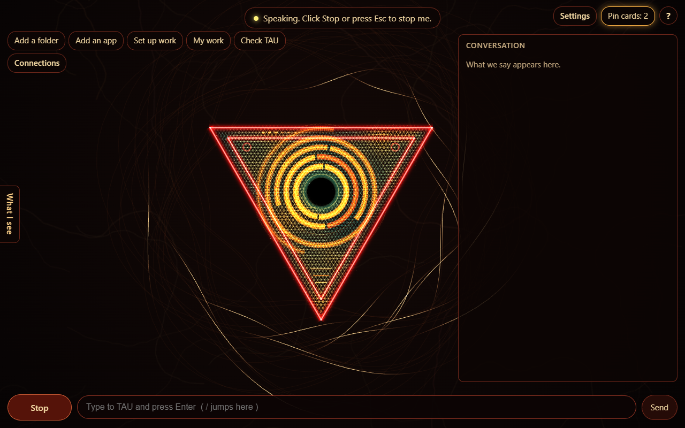

<p align="center"></p>

# TAU


A Frak'd-Up Media™ product by R. Anthony Beckett.

TAU is a voice-first assistant for your computer and home lab. You talk or type to it, and it answers out loud and on its own display, a glowing red triangle with rings.
It watches the things you choose (model servers, services, drives, the graphics card) and can only change something after you give it permission.
It runs on your own computer, with a model server you already have or one it installs for you, and it's built to be calm and plain to use.

**Install on Windows 11.** Press Windows+R, paste this, press Enter:

```
powershell -NoProfile -ExecutionPolicy Bypass -Command "irm https://raw.githubusercontent.com/RAnthonyBeckett/tau/main/install.ps1 | iex"
```

**Install on Linux.** In a terminal:

```bash
curl -fsSL https://raw.githubusercontent.com/RAnthonyBeckett/tau/main/install.sh | bash
```

**About TAU's voice.** TAU speaks with the open voices it installs (Kokoro). It does not ship, and never will ship, a copy of the voice from the 2018 Netflix film *Tau*: nobody has Gary Oldman's permission to clone his voice. If you want that voice, you source it yourself, for your own copy. TAU is not affiliated with Netflix or the film.

**How long it takes.** About 3 minutes on a fast connection and up to 15 on a slow one, with about 1.8 GB to download (1.4 GB of packages and 0.5 GB of voice and hearing models). Measured: 140 seconds on a clean GitHub Windows machine. If setup installs a model server for you as well, add 1.5 to 6 GB; setup says the size before it starts.

**What you'll see.** The installer says what it's doing at every step, one plain line at a time, and never sits silent. You don't need admin rights, Python, git or Rust. Then `tau setup` asks a few questions, one at a time, and every one can be skipped. After that, open **TAU** from the Start menu (or your apps menu on Linux). The display opens in its own window, and you don't need a terminal from then on: every setting is on the display under **Settings**.


## Your first conversation

1. Open TAU from the Start menu. The first time, a help panel names every control; click **Got it**.
2. Type into the box at the bottom and press Enter, or click **Talk** (or press Space), speak, and pause. TAU stops listening when you pause.
3. The reply appears in the conversation panel with the time, and is spoken aloud. The status line at the top always says what TAU is doing: ready, listening, working out what you said, thinking (and with which model), speaking, or loading a model and how long that takes.
4. Try "what's my VRAM", "what's on port 8080", "check yourself", or just a question.

## Giving TAU work

Five buttons along the top left do the everyday work path. You can also say or type what they say.

**Add a folder** points TAU at a project. Pick it with the folder dialog, browse to it, or paste its path.
Then choose **Read for context** (the default) or **Let a worker change files here**. TAU shows the
instructions it found (AGENTS.md, CLAUDE.md, STATE.md, and any files listed under `work.house_rules` in
the profile). It never reads keys, `.env` files or hidden settings folders, and forgetting a folder never
touches the files. From the same screen you can read a file and attach it to your next job.

**Add an app** finds Claude Code and Codex if they're installed. "Found" means TAU found the program and it
has the options TAU uses; TAU can't tell if you're signed in or have credit without a paid request.
OpenRig is listed but not connected yet. Desktop apps that only open aren't offered as workers.
An app can offer TAU's connection: it answers on this computer at `<address>/tau/v1/describe` (its name and the
actions TAU may ask for), `/tau/v1/status`, and `/tau/v1/do` (`{"action", "args"}` in, `{"ok", "result"}` out).
Connect it under "Connect an app by its address"; then its actions are buttons, or say "ask <app> to <action>".

**Set up work**, or just say "have Claude work on this ...", makes a draft. The card says in one line who
will work where, with the details underneath. **Send** is the yes. Talking about an idea ("could we...",
"I'm thinking...") never sends anything.

**My work** shows each job and its result. Cancel stops only the worker TAU started; files it already
changed stay changed. "How is it going?" answers from the job record. "Tell it ..." sends your answer
back into the same Claude Code conversation once that job has finished; for other workers, or a job still
running, it makes a linked request with the same project and files. "Where were we?" lists unfinished work.

**Check TAU** runs read-only checks and says what it didn't check.

What each worker may do: Claude Code reads only (`plan` mode) unless the folder allows changes, then it may
edit files in that folder (`acceptEdits`); commands it wants to run are refused because nobody can approve
them mid-job. Codex uses its own sandbox (`read-only` or `workspace-write`). A custom worker can't be limited
by TAU, so it needs a ticked "I understand". Sending work to another machine isn't built yet.

## The display's controls

| Control | Where | What it does |
|---|---|---|
| **Talk** | bottom left | Click, then speak. Click again to stop listening. While TAU speaks it says **Stop**. Shortcut: Space |
| **Type box** | bottom | Type and press Enter. Shortcut: / |
| **Status line** | top | What TAU is doing right now. After you change a setting, it says what changed |
| **Settings** | top right | Every setting, one section at a time (see "Settings" below). Changes take effect at once |
| **Pin cards** | top right | Answers TAU kept for you. Glows when some are waiting. The three marks at the triangle's bottom tip glow too |
| **?** | top right | The help panel again; it names every control |
| **What I see** | tab at the left edge | A panel that slides out from the tab. Closed until you open it, and it stays open or closed the way you left it. Its sections open and close: **Status** writes out every reading on the rings ("GPU: 6.1 GB free", "llama-server: up", "Brain: gemma-4-26B, answering"); **Machines** has one row per machine with "connected now" or "paired, not connected"; **Pins**; and **Recent actions** with a receipt for each (see "Receipts"). Click a reading for its details card; anything marked "off — turn on in Settings" opens that section |
| **Conversation** | right | Both sides, with the time on each message and a **Copy** button. Pin cards show inline; the message TAU is speaking is marked "Speaking now" |
| **Hands-free** | bottom right | Off unless you switch it on. When it's on, any speech starts listening, not just a click |
| **Rings** | centre | One piece per thing TAU watches (no number tags: they hid the display). Hover a piece to see its name and value. Lit is fine, dim is asleep, pulsing amber needs a look, faint is switched off. Click a piece for its details card: what it is, when it was last checked, **Check now**, **Open in Settings**, and **Start**/**Stop** for a service you allowed |
| **Centre** | middle of the rings | Same as Talk |
| **Ticks** | along the top edge | One per permission. Brighter means TAU may do more. Change them in Settings, Permissions |
| **Corners** | top left / top right | Quiet (TAU stops listening and speaking) and Hard day (short, literal answers). They glow when on |

Warnings flash the frame and show one line that stays until you dismiss it. Anything that needs fixing also gets a pin card with the steps.

## Settings

**Settings** (top right) opens one panel with eight sections down the left. Each shows its current values, and each change is saved at once and repeated on the status line.

| Section | What's in it |
|---|---|
| **Brain** | The brain in use and whether it's answering. **Check again** lists every model server and every model with its size, whether it's MoE (mixture of experts) or dense where the name or the model file says so, whether it fits your computer and whether it's in memory. **Use this** switches model after a test message; **Test the brain now** sends one |
| **What I watch** | Each sense as an on/off switch with one line saying what it reads. The services TAU checks, with **Remove**; **Add a service** by program name, port or web address; **Look for services on this machine** suggests what's running (never temporary ports) |
| **Permissions** | Each capability's level as four buttons: Off, Look, Suggest, Act. Suggest asks before every change. Act does changes without asking and leaves a receipt; only destructive things (like deleting a file) still ask. Choosing Act asks you once to confirm that choice |
| **Voice and hearing** | Voice choice (a voice that isn't on this computer yet downloads when you pick it, then plays a sample) and **Play a sample**; microphone and speaker pickers with **System default** first and each device listed once, **Test the microphone** (a live level for three seconds) and **Test the speaker** (says "played" or the exact failure); the hands-free switch with its privacy sentence; the wake word's status and what training it needs |
| **Name and how I speak to you** | TAU's name, your name, how TAU speaks to you |
| **Pacing profile** | The pacing profile on or off, longest reply, and each rule as a switch, including Hard day |
| **Display** | Pop-out corner and screen, **Open the pop-out now**, and the display's port |
| **Lab** | This machine's role (hub or node), the hub's address and port, paired machines with a **nickname** field each, and **Pair a machine**, which shows a one-time code on screen. On a node, type the hub's address and the code |

Settings writes `profile.yaml` through the same code `tau setup` uses, so `tau setup <topic>` still works for scripts.

## Speakers and microphones

Windows lists each sound device several times, once per audio system (MME, DirectSound, WASAPI, WDM-KS). TAU lists each device once, using the WASAPI entry where there is one and MME otherwise, with **System default** first and chosen until you pick another. The choice is saved as audio system, number and name, and matched exactly, so picking one lights only that one. If the device's number changes (you plugged something in), the same name on the same audio system is found again.

TAU opens the speaker and microphone in shared mode at a rate the device accepts, and converts: her voice (made at 24 kHz) to the speaker's rate, and the microphone's rate to the 16 kHz hearing uses. A new choice takes effect at once. If the chosen speaker fails while she speaks, she uses the system default and says so on the display. If speaking fails for any other reason (a missing voice file, for example), the display flashes, a pin card says why in plain words, and the reply is still there as text.

`tau fetch-models` downloads every voice Settings offers (about half a megabyte each), so switching voice works offline.

## Hearing and hands-free

There's no ready-made wake word model yet (see "Wake word" below), so by default you start talking with **Talk** or Space. Hands-free mode is off by default. When it's on, TAU checks everything the microphone hears for speech and turns any speech into text on this computer, so nearby talk may be picked up; nothing is saved or sent anywhere until it becomes a message. Switch it with the **Hands-free** button or in Settings, Voice and hearing.

If the microphone doesn't work, the display flashes a warning, the microphone piece of the inner ring pulses amber, and a pin card has the steps to fix it. You can keep typing meanwhile.

## What TAU watches

Setup offers a starter set in one question: the graphics card (if it found one), your drives, the brain's models, notifications, and up to eight services it found running (model servers first, operating-system services left out). Say no and it asks about each one in turn. All of it is read-only. Change it later in Settings, What I watch. Services are saved by their fixed port; a program on a temporary port (49152 and up) is saved by its parent's fixed port, such as a llama.cpp router's 8080, or left out, because a temporary port changes every restart.

## Changing the brain

TAU needs a brain: a model server or a cloud service. `tau setup` finds what's already running (llama.cpp's `llama-server`, LM Studio, Ollama, vLLM, or any OpenAI-compatible server) and lists how many models each has, with the ones that fit your computer first. If nothing is running it offers to install Ollama and one small Apache-2.0 model sized to your computer, and says the download size and time before asking. **Check again** looks once more after you start a server yourself. You can also type a server's address or paste a cloud service's address and key (the key goes in a private `.env` file, never the profile). TAU sends one short test message and only saves a brain that answers.

To change it later: Settings, Brain.

## Permissions

TAU starts able to listen, talk and show its display, plus whatever you chose to watch during setup. Every other power is a separate permission (an "organ") with four levels: `off`, `sense` (look only), `suggest` (asks before changing anything) and `act`. Change them in Settings, Permissions. See "The permission model" below.

### Receipts

"We give her access slowly and with receipts." Every change of a permission level (in Settings or by voice) and every action at suggest or act level leaves a receipt: what, when, which machine, and who approved ("you, in Settings", "you said yes (display)", "you said no", or "services is at Act, so no yes was needed"). Approved actions that then fail get one too. Receipts live in `log/actions.jsonl` with the rest of the action log, and the side panel's **Recent actions** section reads them from there. TAU's own speaking and replying leave none. A suggestion waiting for your yes shows as a card with **Yes** and **No** above the type box.

## Uninstall

Windows, in Windows+R:

```
powershell -NoProfile -ExecutionPolicy Bypass -Command "& ([scriptblock]::Create((irm https://raw.githubusercontent.com/RAnthonyBeckett/tau/main/install.ps1))) -Uninstall"
```

Linux: `curl -fsSL https://raw.githubusercontent.com/RAnthonyBeckett/tau/main/install.sh | bash -s -- --uninstall`

Both remove TAU's Python environment (`%LOCALAPPDATA%\TAU` or `~/.local/share/tau`), the `tau` command, and the Start-menu shortcut or menu entry. Your settings and TAU's notes stay in TAU's home folder (`tau status` shows it); delete that folder too if you want everything gone. A model server that setup installed (Ollama) is a normal program: uninstall it the usual way.

## Troubleshooting

**Windows Defender or your antivirus flags a download.** TAU's installer downloads uv (astral.sh, from GitHub), Python packages from PyPI and the PyTorch index, and models from Hugging Face. None of it is compiled on your computer. Antivirus tools sometimes flag genuine developer tools; round 3 removed the Rust toolchain download that Defender flagged as `Trojan:Win32/Suschil!rfn`. If something is flagged, check its source in the install log, and send the log to whoever gave you TAU before allowing anything.

**"I didn't find a model server."** Start your server (for example `llama-server -m <your model>`, or open LM Studio and start its server), then pick **Check again**. Or let setup install Ollama and a small model. Or skip; TAU still watches services without a brain, and `tau setup brain` connects one later.

**TAU doesn't hear you.** Look at the microphone piece of the inner ring and the pin cards: a failure there comes with the fix. On Windows, check Settings > Privacy & security > Microphone > "Let desktop apps access your microphone". Then `tau check` runs a guided test, one device at a time. Talk only listens after you click **Talk** or press Space, unless hands-free is on.

**The installer says another account is signed in.** You ran it from a window opened with "Run as administrator" that belongs to a different account (for example the built-in Administrator). Installing there would put TAU in that account's folders and your Start-menu shortcut would open nothing (this happened on the first real install). Open PowerShell normally and run the same command. TAU needs no admin rights.

**Something else went wrong.** Every failure says what broke, the next step, and where the log is. TAU's log is `log/tau.log` in TAU's home folder; the installer's log is in `logs/` inside the install folder. `tau doctor` checks each part and says what's missing.

**Other options.** `-DryRun` / `--dry-run` shows what would happen, `-NoVoice` / `--no-voice` installs text only, `-NoSetup` / `--no-setup` stops before setup, `-NoModels` / `--no-models` skips the model downloads, and `-UseOpenJarvisInstaller` / `--use-openjarvis-installer` uses OpenJarvis's own installer (it compiles Rust and installs Ollama, and takes much longer). From a checkout: `powershell -ExecutionPolicy Bypass -File tau\install.ps1` or `bash tau/install.sh`.

---

The rest of this file is reference, written so a person or another AI agent can pick TAU up cold.

## How TAU is installed

The installers make TAU's own Python 3.12 environment with a private copy of [uv](https://github.com/astral-sh/uv) (MIT/Apache-2.0), then install OpenJarvis from PyPI (plain Python; nothing TAU calls needs OpenJarvis's optional Rust extension), TAU with its voice, display and Windows extras, the CPU-only build of torch, and Kokoro without its GPL extras. `tau fetch-models` then downloads the voice and hearing models, and `python -m tau.launcher install` adds the `tau` command and the menu entry. On Windows the `tau` command is a small `tau.cmd` in `%LOCALAPPDATA%\TAU\bin`, which goes on your user PATH (not the environment's `Scripts` folder, which would replace your own `python`). The shortcut runs `pythonw -m tau run --window --no-console`.

Manual install into an existing environment (Python 3.10 to 3.13):

```bash
pip install "tau[voice,display] @ file:///path/to/tau"     # add ,windows on Windows
pip install --no-deps -r requirements-kokoro.txt            # Kokoro + misaki without their GPL extras
tau fetch-models
tau setup
tau run --window
```

## Setup in detail

`tau setup` asks one plain question at a time. A choice is only marked "recommended" when there's a reason, and the reason is shown. Every question can be skipped and answered later with `tau setup <topic>` (topics: `brain`, `names`, `hub`, `lab`, `senses`, `devices`, `display`, `pacing`, `voice`, `handoff`, `ports`). Everything here is also in Settings on the display.

1. **One yes to look around.** Read-only: OS, CPU, RAM, GPU and VRAM, microphones, speakers, cameras, monitors, installed agent tools (`claude`, `codex`, ...), running model servers.
2. **Connect a brain** (see "Changing the brain" above).
3. **Only what it couldn't detect**: what to call TAU, your name and how you like to be spoken to, whether this machine is the hub, which screen corner the pop-out sits in, and whether you want hands-free.
4. **Map the lab** (read-only, already covered by the first yes), and with one more yes, list other devices on your network from the neighbour table only. No port scanning.
5. **What TAU watches** (see above).
6. **Offer the communication and pacing profile** (off unless you say yes; see below).
7. **Ports.** TAU's display and hub use fixed ports, 47110 and 47111 unless those are taken or you type others (1024 to 49151). They never change between restarts. If the display's port is busy when TAU starts, it uses the next free one and saves it; if TAU is already running there, it opens that one.

Setup writes `profile.yaml` in TAU's home folder (`$TAU_HOME`, or `tau/` inside OpenJarvis's config folder). It is filled from `profile.example.yaml`, whose every machine-specific value is a `{{PLACEHOLDER}}`. A skipped answer becomes `null` (that feature stays off). `tau doctor` refuses a profile with any `{{...}}` left. `profile.yaml` and `.env` are never shipped.

The name is a setting: `tau.name`, `tau.wake_word` and `tau.voice_name`. To rename, change those and train a new wake model (below).

## The permission model ("organs")

Each capability is an organ with a level you set:

| Level | Meaning |
|---|---|
| `off` | not loaded |
| `sense` | may read state |
| `suggest` | may propose an action and wait for your spoken or clicked yes |
| `act` | may act and tell you in one sentence |

Destructive actions (stopping a process, deleting a file) always wait for a yes, whatever the level.
A fresh profile has `voice`, `display` and `chat` at `act`, plus whatever you chose to watch in setup at
`sense`; everything else `off`.

```bash
tau grant services suggest          # TAU repeats the change and asks for a yes first
tau grant gpu act --machine workshop
tau revoke files
```

Or say it: "Tau, you can start services without asking." TAU repeats what will change and waits for "yes".
Every action, allowed or not, is a line in `log/actions.jsonl` (secrets are redacted). Organs that run
commands or touch files check `allow.commands` / `allow.paths` in the profile. Commands you wrote into the
profile yourself (service start/stop, app-prep launch, hand-off templates) count as allowed by being there.

Organs: `voice`, `display`, `chat`, `services`, `notifications`, `gpu`, `window`, `processes`,
`heartbeat`, `cmdfail`, `drives`, `appbridge`, `models`, `apps`, `handoff`, `clipboard`, `files`,
`knowledge`, `gesture`. Each organ action is also registered as an OpenJarvis tool named
`tau_<organ>_<action>`, so OpenJarvis agents get exactly the powers you granted TAU.

## How a request flows

1. **Ears** (zero tokens on dead air): openWakeWord hears the name, a soft chime plays, Silero VAD follows
   the speech, 800 ms of silence closes the gate, faster-whisper (CPU, int8) writes it down. A rolling
   2-second buffer lives in memory only; no audio is ever written to disk. The Talk button, Space and
   the core open the gate too, and hands-free mode (off by default) opens it on speech alone.
2. **Reflexes** (`reflexes.yaml`): phrases like "what's my VRAM", "start/stop <service>", "prep for <app>",
   "switch to <model>", "quiet", "what's on port N" run directly in well under 100 ms with no model call.
   Add your own in `<TAU home>/reflexes.yaml`.
3. **Heavy work** (code, several files, debugging) goes to the **agent hand-off**: the request, a state
   header and the last error text are packaged and sent through a command template in the profile
   (Claude Code CLI, Codex CLI, any command, or a coordinator such as OpenRig's `rig send`). TAU says in
   one sentence where it went.
4. Otherwise **one model call** through a brain lane, with a ~60-token JSON state header (host, focused
   window, VRAM, services up, last error, workspace) built only from organs you allowed.
5. **Post-check**: the style guard (optional banned-words list, one rewrite per hit) and the pacing rules.
6. **Output**: a path, command or one-liner goes to the clipboard ("it's on your clipboard"); a short
   answer is spoken and kept on a **pin card** until you open or clear it. Nothing disappears on a timer.
   Code never goes on the display.

### Brain lanes and the GPU rule

`brain.local` (a model on your hardware, through OpenJarvis engines) and `brain.burst` (any cloud or router
endpoint) are both optional. When the `gpu` organ may sense, TAU reads free VRAM with `nvidia-smi`; if a
heavy app named in `brain.gpu.heavy_apps` holds the card, or free VRAM is under the floor, it uses the
burst lane. It never loads a second local model while one is resident, and with `gpu` at `act` it may ask
the local server to unload. Nothing runs on a timer.

## Hub and nodes: one TAU for the whole lab

There is one TAU (one brain, one memory, one display, one profile) on a hub machine you pick. Every other
machine runs the small node helper:

From the display: on the hub, Settings, Lab, **Pair a machine** shows a one-time code. On the other machine, Settings, Lab, choose Node, type the hub's address and the code, and press **Join**. Or from a terminal:

```bash
# on the hub
tau pair                     # prints a one-time code, valid 10 minutes
# on the other machine (after installing TAU there too)
tau node --pair ABCD-EFGH --hub <hub address>:<hub port>
tau node                     # later runs: reconnects with the stored key
```

The node opens no listening port; it keeps one outgoing connection to the hub. Pairing is SPAKE2 (a PAKE,
via the MIT-licensed `spake2` package), so a recording of the pairing can't be used to test guesses
offline; the hub burns the code after three wrong tries. Both sides confirm the shared key, then the hub
hands the node a fresh random key sealed with it. After that every
connection gets its own session key (HKDF) and every frame is AES-GCM with a sequence number. The hub
listens on the LAN address chosen at setup only, never on all interfaces unless you add `hub` to
`network.lan_opt_in`. The display and every other service stay on loopback.

## The lab map

Discovery is read-only and asks nothing beyond the first yes. It records each machine's OS, CPU, RAM,
GPU/VRAM, drives (network and slow ones are marked and never walked), system services (Windows services,
systemd units), listening ports with the owning process, Docker containers, agent CLIs and model servers.
The hub writes it as an OKF folder in `tau_brain/lab/`: one note per machine, per service and per drive,
plus `index.md` and `log.md`. TAU answers "what's running on <machine>", "what's on port N" and "what
services does the lab have" from these notes with no model call. Refresh with `tau discover` or
"Tau, re-check the lab".

Machine names match in any case, by the first few letters when only one machine starts that way
("Hal" for Halcyon), and by nicknames you set in Settings, Lab (each paired machine gets its short
hostname as its first nickname). A name that matches nothing gets the list of machines TAU knows.

### Which program owns each port (Linux nodes)

The node helper runs as you, so on Linux `ss` can't name programs that belong to other users: Plex's
32400, for example, shows as unknown. To let TAU name them, run on that node:

```bash
tau node --setup-port-owners
```

It prints one sudoers line that allows exactly `ss -tlnpH` (a read-only list of listening TCP ports and
their programs) without a password, for example
`alice ALL=(root) NOPASSWD: /usr/bin/ss -tlnpH`, and asks whether to install it in
`/etc/sudoers.d/tau-port-owners` with your sudo. sudo asks for your password itself; TAU never asks for,
sees or stores it. The line is checked with `visudo -c` before it is installed. Discovery then runs
`sudo -n ss -tlnpH` (`-n` never prompts) and fills in the programs. Say no and the command tells you how to
add the line yourself. To undo: `sudo rm /etc/sudoers.d/tau-port-owners`.

## TAU's own brain files

TAU keeps its working memory as plain markdown in an OKF folder (`tau_brain/`, chosen at setup):

| File | What it holds |
|---|---|
| `journal.md` | dated log of done / next / shelved, newest first; TAU reads the top entry when it starts |
| `user.md` | who you are and how you want to be spoken to, from setup answers and corrections |
| `rules.md` | standing rules you gave, each with the date and your words |
| `lab/` | the lab map |
| `workspaces.md` | your projects and folders and what each is for |
| `components.md` | installed tools, model servers and agent CLIs: path, launch, port, reads/writes, used by |
| `private/` | sensitive notes (pacing reasons); never put in a model prompt |
| `index.md`, `log.md` | as OKF requires |

When you correct TAU ("from now on, use the local model first", "call me Sam"), the correction goes into
`rules.md` or `user.md` straight away. The files on disk are the truth: TAU re-reads and inserts into them,
so your own edits always win.

## OKF (Open Knowledge Format)

[OKF v0.2](https://github.com/GoogleCloudPlatform/knowledge-catalog/tree/main/okf) is TAU's knowledge
format: folders of markdown with YAML frontmatter, `index.md` per folder, `log.md` history, and the trust
fields `sources`, `generated`, `verified`, `stale_after` and `status`. TAU reads any OKF folder you list in
`knowledge.okf_folders`, ranks human-reviewed over machine-confirmed over unverified, warns on stale,
draft and deprecated concepts, and writes everything it stores as valid OKF. Validate a folder with
`tau okf validate <folder>`.

Other knowledge sources: your folders indexed into SQLite FTS5 (opt-in per folder, queried on disk, never
loaded into memory whole), any MCP server you list (TAU is a client, through OpenJarvis's MCP client), your
own identity files (markdown about you, loaded into the system prompt), and OpenJarvis's own memory.

## Communication and pacing profile

Off by default and offered at first run, for anyone who wants it; it was built with neurodivergent people
and people with chronic pain or fatigue in mind. Each item is its own setting: maximum reply length,
whether lists are allowed, answer first, one thing per reply, restating the key decision when a topic comes
back, few and rounded numbers (exact ones on a pin card), saying what TAU will touch before touching it,
never assuming you're finished, never pushing the next step, a "hard day" switch ("Tau, hard day"), and
overwhelm signals described in your own words. Length, list and number rules are enforced locally after
every reply.

**Privacy.** Your reasons (any condition you note) are kept in `tau_brain/private/` and never sent anywhere;
only the neutral rules go into a model prompt. If a cloud lane is set up when the profile is switched on,
or added later, TAU explains this plainly and offers three choices: keep going, use the local lane only
while the profile is on, or turn the profile off. The choice is recorded in `rules.md`. A test checks that
the reasons never appear in any outgoing request.

## The display

`tau run --window` (what the Start-menu shortcut runs) opens the display in its own window; `tau run` opens it in your browser on loopback; `tau run --popout` opens a small frameless always-on-top version parked in the corner you chose. The page holds everything TAU shows: the status line, the conversation, pin cards, warnings and every control (see "The display's controls" above). The red double-line triangle is TAU's overall state: idle (slow breathing), listening (the inner rings close like a shutter), thinking (the frame pulses), speaking (the rings brighten and swell slightly with her voice, then settle when she stops), error or warning (the frame flickers). The rings are ranked by importance: innermost and brightest matter most. A light background check every 30 seconds (no model calls) keeps them up to date. 60 fps while active, 10 fps while a full-screen or heavy app has focus.

## Senses

All off until granted (setup offers a starter set): focused window and processes; GPU memory; service heartbeats (`health_url`, or the service's port for services setup found);
command failures, captured at run time by `tau wrap -- <command>` (keeps the stderr tail) or by a shell
hook from `tau hook bash|zsh|powershell` (exit code only; a hook can't see stderr and TAU doesn't pretend
to); drives (slow and network drives are never walked); and app bridges for apps with a local API (example:
`http_json`). TAU never reads the inside of canvas apps such as game engines or video editors.

## Add your own organ

Drop a Python file in `<TAU home>/organs/`; TAU imports it at start.

```python
# <TAU home>/organs/printer.py
from tau.organs import Organ, OrganRegistry

printer = OrganRegistry.add(Organ("printer", "check and pause the 3D printer"))

@printer.action("status", "read", "read the printer status")
def status(organs, machine=None):
    return {"say": "The printer is idle."}

@printer.action("pause", "change", "pause the print")
def pause(organs, machine=None):
    organs.check_command("printerctl pause")       # honours allow.commands
    ...
    return {"say": "Paused."}
```

Then `tau grant printer sense`, and add a reflex in `<TAU home>/reflexes.yaml`:

```yaml
- name: printer_status
  patterns: ["^how'?s the printer\\??$"]
  organ: printer
  action: status
```

## Wake word

openWakeWord's stock models are licensed for non-commercial use only, so TAU ships none. Train your own:

```bash
pip install onnx            # plus the Kokoro step from Install
python scripts/train_wake_word.py --name tau --out ~/tau_wake.onnx
tau setup voice      # or set tau.wake_model in profile.yaml
```

The script speaks the name with Kokoro (Apache-2.0) in many voices and speeds, builds hard negatives from
similar-sounding words, and trains a small network on openWakeWord's features. Add your own recordings with
`--positives-dir` and extra negatives (for example a CC0 speech set) with `--negatives-dir`. `--selftest`
checks the pipeline with synthetic audio. Until a model exists, the Talk button, Space and hands-free mode work.

## Commands

| Command | What it does |
|---|---|
| `tau setup [topic]` | first-run setup, or one topic again |
| `tau run [--window] [--popout] [--text] [--no-console]` | start TAU |
| `tau fetch-models` | download the voice and hearing models now |
| `tau grant <organ> <level>` / `tau revoke <organ>` | change a permission (asks first) |
| `tau status` | name, lanes, organ levels, paired nodes, waiting pin cards |
| `tau doctor` | checks each organ and OpenJarvis's own checks, in plain words |
| `tau check` | guided hardware check, one device at a time: microphone level, speaker chime, click-to-talk, wake word, transcription of one sentence, GPU, each granted sense, each paired node. Passed / failed (with a fix) / skipped; results go to the journal and each failure gets a pin card. Also by voice: "Tau, check yourself" |
| `tau licence-check` | fail on GPL/AGPL dependencies or non-commercial models; `--write-readme` regenerates the table below |
| `tau discover` | re-map this machine |
| `tau pair` / `tau node` | add a machine to the lab |
| `tau wrap -- <cmd>` / `tau hook <shell>` | capture failed commands |
| `tau okf validate <folder>` | check an OKF folder |
| `tau say "<words>"` | one line in, one reply out |

OpenJarvis's own `jarvis` commands keep working alongside.

## Tests

```bash
pip install -e ".[voice,display,dev]"     # dev = pytest and Playwright
python -m playwright install chromium     # for the display's browser test
pip install --no-deps -r requirements-kokoro.txt
pytest
```

CI (`.github/workflows/tau.yml`) runs the suite on real Windows and Linux runners (Python 3.11 and 3.13),
including the display's headless-browser test, plus `tau discover --dry-run` on each runner (uploaded as an
artifact), the licence gate, both installers' dry runs (Windows PowerShell 5.1 and PowerShell 7), and a real
`install.ps1` install on a clean Windows runner under each of them, which also checks that no Rust toolchain or
Ollama appeared, that a fresh shell finds `tau`, that the Start-menu shortcut is real, and that uninstalling
removes both. Opt-in extras: `TAU_TEST_DOCKER=1` (PowerShell parse test in a container),
`TAU_TEST_KOKORO_DOWNLOADS=1` (real Kokoro audio and the unknown-word fallback).

## Dependencies and licences

Permissive licences only for TAU's code and anything it ships. TAU ships no model files. `tau licence-check`
resolves every installed dependency of the core and each extra, fails on GPL or AGPL (LGPL and MPL are
allowed and listed), and fails if any model the code downloads has a non-commercial card licence. The table
below is generated from the same data with `tau licence-check --write-readme`. It was made on Linux with
the core and voice extras installed; packages of extras that weren't installed there are listed by name and
checked on CI. The Three.js build in `display/static/vendor/` is MIT and the OKF spec is Apache-2.0.

<!-- licence-table:start (generated by `tau licence-check --write-readme`) -->
| Package | Version | Licence | Needed by |
|---|---|---|---|
| aiohappyeyeballs | 2.7.1 | Python Software Foundation License | core |
| aiohttp | 3.14.5 | Apache-2.0 AND MIT | core |
| aiosignal | 1.4.0 | Apache Software License | core |
| annotated-types | 0.8.0 | MIT | core |
| anyio | 4.16.0 | MIT | core |
| attrs | 26.1.0 | MIT | core |
| backoff | 2.2.1 | MIT License | core |
| certifi | 2026.10.23 | Mozilla Public License 2.0 (MPL 2.0) (weak copyleft, used unmodified) | core |
| cffi | 2.1.1 | MIT-0 | core |
| charset-normalizer | 3.5.2 | MIT | core |
| click | 8.5.0 | BSD-3-Clause | core |
| croniter | 6.2.4 | MIT | core |
| cryptography | 50.0.2 | Apache-2.0 OR BSD-3-Clause | core |
| datasets | 5.1.0 | Apache Software License | core |
| ddgs | 9.16.1 | MIT | core |
| dill | 0.4.1 | BSD License | core |
| distro | 1.9.0 | Apache Software License | core |
| filelock | 4.2.9 | MIT | core |
| frozenlist | 1.8.0 | Apache-2.0 | core |
| fsspec | 2026.7.0 | BSD-3-Clause | core |
| h11 | 0.16.0 | MIT License | core |
| hf-xet | 1.8.0 | Apache-2.0 | core |
| httpcore | 1.0.9 | BSD-3-Clause | core |
| httpcore2 | 2.16.0 | BSD-3-Clause | core |
| httpx | 0.28.1 | BSD License | core |
| httpx2 | 2.16.0 | BSD-3-Clause | core |
| huggingface_hub | 2.4.0 | Apache Software License | core |
| idna | 3.20 | BSD-3-Clause | core |
| jiter | 0.18.0 | MIT | core |
| lxml | 6.1.3 | BSD-3-Clause | core |
| markdown-it-py | 4.2.0 | MIT License | core |
| mdurl | 0.1.2 | MIT License | core |
| multidict | 7.2.1 | Apache-2.0 | core |
| multiprocess | 0.70.19 | BSD License | core |
| numpy | 2.5.4 | BSD-3-Clause AND 0BSD AND MIT AND Zlib AND CC0-1.0 | core |
| nvidia-ml-py | 13.615.71 | BSD License | core |
| openai | 3.46.0 | Apache-2.0 | core |
| OpenJarvis | 1.0.4 | Apache Software License | core |
| packaging | 26.3 | Apache-2.0 OR BSD-2-Clause | core |
| pandas | 3.1.1 | BSD-3-Clause | core |
| posthog | 7.83.2 | MIT | core |
| primp | 2.0.1 | MIT License | core |
| propcache | 0.5.4 | Apache-2.0 | core |
| psutil | 7.2.2 | BSD-3-Clause | core |
| pyarrow | 26.0.1 | Apache-2.0 | core |
| pycparser | 3.12 | BSD-3-Clause | core |
| pydantic | 2.14.2 | MIT | core |
| pydantic_core | 2.50.2 | MIT | core |
| Pygments | 2.21.0 | BSD-2-Clause | core |
| python-dateutil | 4.0.0 | BSD-3-Clause | core |
| python-telegram-bot | 22.8 | LGPL-3.0-only (weak copyleft, used unmodified) | core |
| PyYAML | 6.0.3 | MIT License | core |
| requests | 2.34.2 | Apache Software License | core |
| rich | 15.0.0 | MIT License | core |
| sniffio | 1.3.1 | MIT License / Apache Software License | core |
| spake2 | 0.9 | MIT License | core |
| tomlkit | 0.15.2 | MIT | core |
| tqdm | 4.70.1 | MPL-2.0 AND MIT (weak copyleft, used unmodified) | core |
| truststore | 0.10.5 | MIT | core |
| typing-inspection | 0.4.5 | MIT | core |
| typing_extensions | 4.16.0 | PSF-2.0 | core |
| tzdata | 2026.6 | Apache-2.0 | core |
| urllib3 | 2.8.0 | MIT | core |
| websockets | 17.4 | BSD-3-Clause | core |
| xxhash | 4.0.2 | BSD-2-Clause | core |
| yarl | 1.25.1 | Apache-2.0 | core |
| addict | 2.4.0 | MIT License | voice |
| annotated-doc | 0.0.5 | MIT | voice |
| av | 19.0.2 | BSD-3-Clause | voice |
| blis | 1.3.4 | BSD License | voice |
| catalogue | 2.0.10 | MIT License | voice |
| cloudpathlib | 0.26.0 | MIT License | voice |
| cloudpickle | 3.1.2 | BSD License | voice |
| confection | 1.3.4 | MIT License | voice |
| ctranslate2 | 4.8.5 | MIT | voice |
| cuda-bindings | 13.4.4 | Apache-2.0 | voice |
| cuda-pathfinder | 1.8.5 | Apache-2.0 | voice |
| cuda-toolkit | 13.2.2 | not stated | voice |
| cymem | 2.0.16 | MIT License | voice |
| docopt | 0.6.2 | MIT License | voice |
| en_core_web_sm | 3.8.0 | MIT | voice |
| faster-whisper | 1.2.1 | MIT License | voice |
| flatbuffers | 25.12.19 | Apache Software License | voice |
| Jinja2 | 3.1.6 | BSD License | voice |
| joblib | 1.6.0 | BSD-3-Clause | voice |
| kokoro | 0.9.4 | Apache Software License | voice |
| loguru | 0.7.3 | MIT License | voice |
| MarkupSafe | 3.0.4 | BSD-3-Clause | voice |
| misaki | 0.9.4 | Apache Software License | voice |
| mpmath | 1.3.0 | BSD License | voice |
| murmurhash | 1.0.16 | MIT License | voice |
| narwhals | 2.28.0 | MIT | voice |
| networkx | 3.7 | BSD-3-Clause | voice |
| num2words | 0.5.14 | GNU Library or Lesser General Public License (LGPL) (weak copyleft, used unmodified) | voice |
| nvidia-cublas | 13.4.1.3 | LicenseRef-NVIDIA-Proprietary (NVIDIA, only with torch's GPU build) | voice |
| nvidia-cuda-cccl | 13.3.5.0.6 | LicenseRef-NVIDIA-Proprietary (NVIDIA, only with torch's GPU build) | voice |
| nvidia-cuda-cupti | 13.2.86 | LicenseRef-NVIDIA-Proprietary (NVIDIA, only with torch's GPU build) | voice |
| nvidia-cuda-nvrtc | 13.2.86 | LicenseRef-NVIDIA-Proprietary (NVIDIA, only with torch's GPU build) | voice |
| nvidia-cuda-runtime | 13.2.86 | LicenseRef-NVIDIA-Proprietary (NVIDIA, only with torch's GPU build) | voice |
| nvidia-cudnn-cu13 | 9.26.0.51 | LicenseRef-NVIDIA-Proprietary (NVIDIA, only with torch's GPU build) | voice |
| nvidia-cufft | 12.2.0.57 | LicenseRef-NVIDIA-Proprietary (NVIDIA, only with torch's GPU build) | voice |
| nvidia-cufile | 1.17.1.22 | LicenseRef-NVIDIA-Proprietary (NVIDIA, only with torch's GPU build) | voice |
| nvidia-cusolver | 12.2.0.11 | LicenseRef-NVIDIA-Proprietary (NVIDIA, only with torch's GPU build) | voice |
| nvidia-cusparse | 12.7.10.12 | LicenseRef-NVIDIA-Proprietary (NVIDIA, only with torch's GPU build) | voice |
| nvidia-cusparselt-cu13 | 0.8.1 | NVIDIA Proprietary Software (NVIDIA, only with torch's GPU build) | voice |
| nvidia-nccl-cu13 | 2.30.7 | LicenseRef-NVIDIA-Proprietary (NVIDIA, only with torch's GPU build) | voice |
| nvidia-nvjitlink | 13.5.37 | LicenseRef-NVIDIA-Proprietary (NVIDIA, only with torch's GPU build) | voice |
| nvidia-nvshmem-cu13 | 3.7.2 | LicenseRef-NVIDIA-Proprietary (NVIDIA, only with torch's GPU build) | voice |
| nvidia-nvtx | 13.2.86 | LicenseRef-NVIDIA-Proprietary (NVIDIA, only with torch's GPU build) | voice |
| onnxruntime | 1.31.1 | MIT License | voice |
| openwakeword | 0.4.0 | Apache Software License | voice |
| preshed | 3.0.15 | MIT License | voice |
| protobuf | 7.36.2 | 3-Clause BSD License | voice |
| regex | 2026.9.29 | Apache-2.0 AND CNRI-Python | voice |
| safetensors | 0.8.0 | Apache Software License | voice |
| scikit-learn | 1.9.1 | BSD-3-Clause | voice |
| scipy | 1.18.1 | BSD License | voice |
| setuptools | 84.2.1 | MIT | voice |
| shellingham | 1.5.4 | ISC License (ISCL) | voice |
| smart_open | 9.0.2 | MIT License | voice |
| sounddevice | 0.5.6 | MIT | voice |
| soundfile | 0.14.0 | BSD License | voice |
| spacy | 3.8.18 | MIT License | voice |
| spacy-legacy | 3.0.12 | MIT License | voice |
| spacy-loggers | 1.0.5 | MIT | voice |
| srsly | 2.5.6 | MIT License | voice |
| sympy | 1.14.0 | BSD License | voice |
| thinc | 8.3.14 | MIT License | voice |
| threadpoolctl | 3.7.0 | BSD-3-Clause | voice |
| tokenizers | 0.23.3 | Apache Software License | voice |
| torch | 2.15.0 | Apache-2.0 AND Apache-2.0 WITH LLVM-exception AND BSD-2-Clause AND BSD-3-Clause AND BSL-1.0 AND ISC AND MIT AND Zlib | voice |
| transformers | 5.22.1 | Apache 2.0 License | voice |
| triton | 3.9.0 | MIT | voice |
| typer | 0.27.3 | MIT | voice |
| wasabi | 1.1.3 | MIT | voice |
| weasel | 1.0.1 | MIT License | voice |
| wrapt | 2.5.2 | BSD-2-Clause | voice |
| bottle | 0.13.4 | MIT License | display |
| proxy_tools | 0.1.0 | MIT License | display |
| pywebview | 6.2.1 | BSD License | display |
| mediapipe | - | not installed where this table was made; checked on CI | gesture |
| opencv-python-headless | - | not installed where this table was made; checked on CI | gesture |

| Model (downloaded on first use) | Licence on its card | Used by |
|---|---|---|
| PeterReid/graphemes_to_phonemes_en_gb | apache-2.0 | tau.kokoro_voice (unknown words) |
| PeterReid/graphemes_to_phonemes_en_us | apache-2.0 | tau.kokoro_voice (unknown words) |
| Qwen/Qwen3-1.7B | apache-2.0 | tau.engines (optional starter model, qwen3:1.7b) |
| Qwen/Qwen3-4B | apache-2.0 | tau.engines (optional starter model, qwen3:4b) |
| Qwen/Qwen3-8B | apache-2.0 | tau.engines (optional starter model, qwen3:8b) |
| Systran/faster-whisper-base.en | mit | tau.ears (transcription, via faster-whisper) |
| explosion/en_core_web_sm | mit | misaki's tokenizer (spaCy model wheel) |
| hexgrad/Kokoro-82M | apache-2.0 | tau.kokoro_voice (voice) |
<!-- licence-table:end -->

Notes to check on your own install:

- openWakeWord's pip package also contains its stock wake models (non-commercial). TAU never loads them: it
  passes only your own model's path.
- The openWakeWord embedding model is derived from Google's speech embedding model; confirm its licence in
  openWakeWord's README before redistributing anything that bundles it.
- faster-whisper depends on PyAV, whose wheels bundle FFmpeg libraries under the LGPL. TAU never calls PyAV
  (it feeds audio as arrays).
- Kokoro is installed with `--no-deps` from `requirements-kokoro.txt`. Its normal install pulls
  `misaki[en]`, which brings `phonemizer-fork` and `espeakng-loader` (GPL-3.0). TAU never needs them: its
  own adapter (`tau/kokoro_voice.py`) loads Kokoro's model without Kokoro's pipeline and uses misaki's
  English G2P with a BART fallback for unknown words. A test checks those packages are absent and that
  `kokoro.pipeline` is never imported. On Python 3.13 add `--ignore-requires-python` to that pip line
  (kokoro and misaki declare <3.13).

## Not built

- The `gesture` organ (webcam hand tracking) is reserved and off; nothing behind it yet.
- A ready-made "Tau" wake model: the script is shipped; the model has to be trained on a machine that can
  download Kokoro.

TAU depends on OpenJarvis and keeps its Apache-2.0 notice; see `NOTICE`. TAU itself is Apache-2.0
(`LICENSE`).
